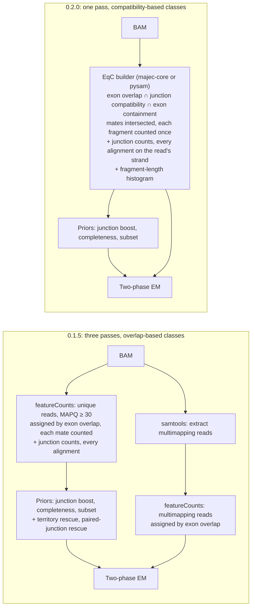
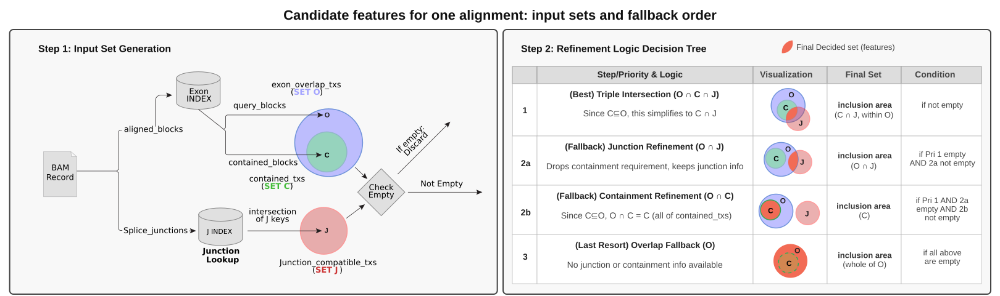
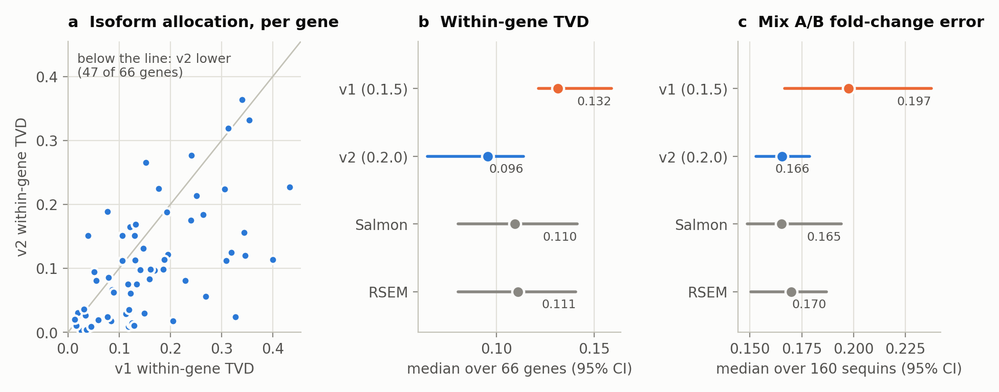
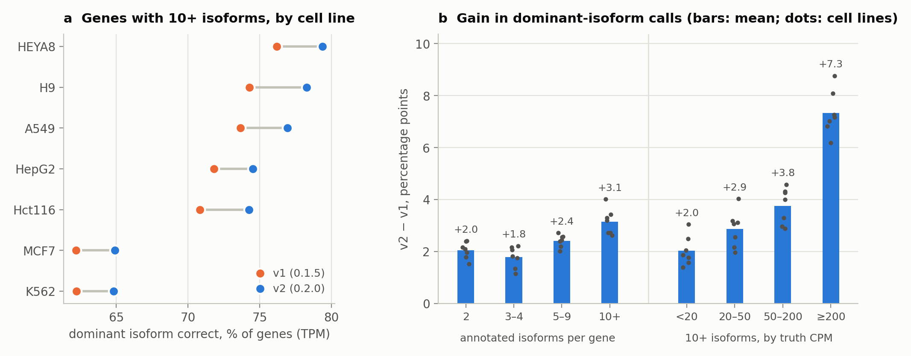
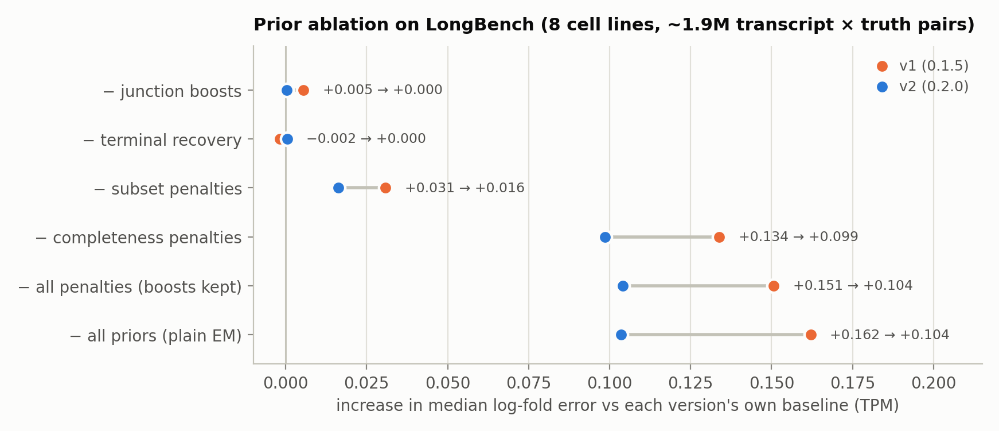
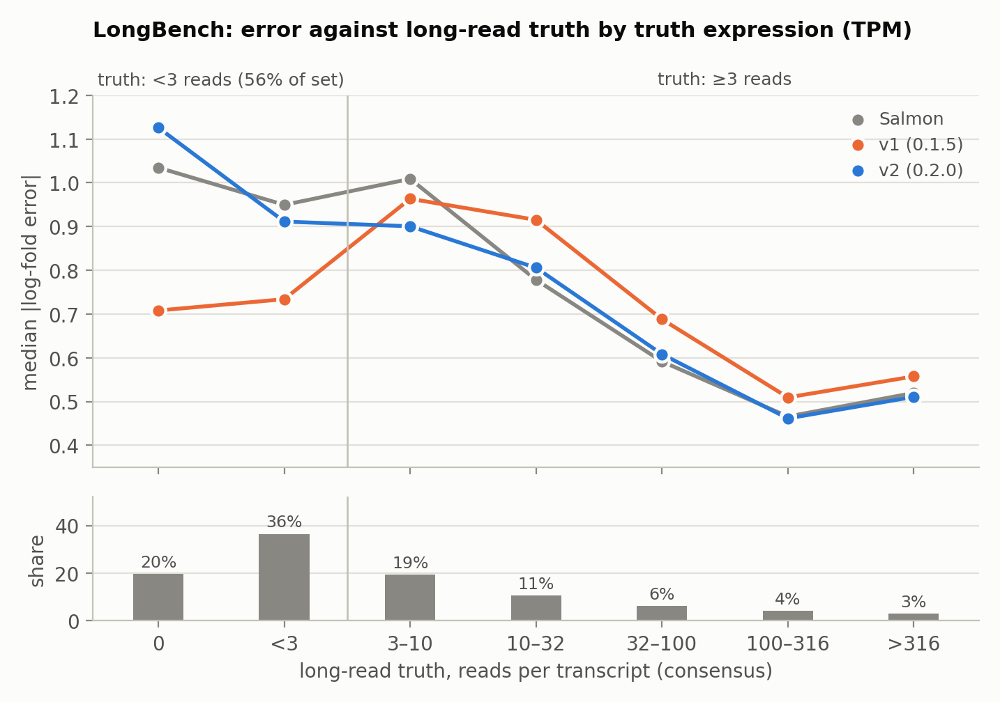

# MAJEC 0.2.0: junction-aware equivalence classes from a single pass over the BAM

**Tian-Yeh Lim and Ari J. Firestone**
Calico Life Sciences

Technical note accompanying the MAJEC 0.2.0 release, November 2026

---

## Summary

MAJEC quantifies genes, transcript isoforms and individual transposable element (TE) loci jointly from aligned RNA-seq reads. It uses an expectation-maximization (EM) algorithm with junction-informed priors (Lim & Firestone 2026).

Version 0.2.0 changes how reads become equivalence classes (EqCs):
- **0.1.5** assigned reads to features by exon overlap, using featureCounts. Splice-junction evidence entered only through the priors.
- **0.2.0** reads each BAM once and gives every fragment a candidate set that already respects annotated junctions and exon boundaries. The two mates of a pair are intersected, and each fragment is counted once.

The EM, the priors and the output files carry over.

We compared the two versions on identical alignments across five benchmarks:
- **Sequins spike-ins.** Within-gene isoform error fell by 27% (total variation distance 0.132 → 0.096). The error in Mix A/B fold changes fell by 16% (0.197 → 0.166). On both measures MAJEC is now level with Salmon and RSEM.
- **SG-NEx (21 libraries).** For genes with 10 or more isoforms, the dominant isoform was called correctly more often: 70.2% → 73.3%, in all seven cell lines.
- **Prior ablation.** Repeating the v1 paper's ablation shows that the junction boost has become redundant. The completeness penalty keeps about three-quarters of its effect.
- **TEs.** The TE results of the v1 paper are unchanged. On a simulation with no TE-derived reads, signal falsely assigned to TEs fell by 43%.
- **The v1 paper's LongBench metric** moves the other way: 0.2.0's margin over Salmon narrows. This comes entirely from transcripts that the long-read truth detects with fewer than three reads. There, 0.1.5's priors suppress expression more strongly, a deliberate design choice that scores well against that truth. Wherever the truth has three or more reads, 0.2.0 is more accurate in every expression bin.

In our runs, 0.2.0 used 3–7× less CPU time than 0.1.5.

---

## 1. Background

MAJEC places every annotated transcript and every annotated TE locus in one feature space. A read overlapping both a gene's exon and an embedded TE is therefore resolved by the EM rather than by a fixed rule (Lim & Firestone 2026). The EM runs in two phases: uniquely mapped fragments first, then multimapping reads distributed according to the unique-read estimates. Its starting abundances are adjusted by evidence-based priors, and a momentum scheme accelerates the iterations. The priors are:
- a **junction boost**, which rewards reads on a transcript's junctions;
- a **completeness penalty**, for transcripts whose annotated junctions are unevenly or never observed;
- a **subset penalty**, for isoforms whose junctions are all contained in a longer isoform;
- an optional **transcript support level (TSL) penalty**.

In 0.1.5, equivalence classes came from three external passes:
- featureCounts over the full BAM, assigning uniquely mapped reads to features and tallying splice-junction reads from every alignment;
- samtools, to extract multimapping reads;
- a second featureCounts pass over those multimapping reads.

featureCounts assigns a read to every feature whose exons it overlaps (Liao et al. 2014). A spliced read was therefore a candidate for isoforms whose introns it contradicts, and the priors had to correct for that. Two further components supported the priors:
- coverage-based "territory" rescue for subset isoforms;
- paired-junction rescue.

Version 0.2.0 moves the junction and exon-boundary evidence into the construction of the classes, so the EM distributes a fragment only among the features that could have produced it.

---

## 2. What changed in 0.2.0

**Figure 1. Quantification flow in 0.1.5 and 0.2.0.**

### 2.1 Equivalence classes from junction compatibility and exon containment

For each alignment, the builder splits the CIGAR into aligned blocks and splice junctions and computes three sets of features:
- **O (exon overlap):** features with an exon overlapping any aligned block.
- **C (exon containment):** features for which every aligned block lies entirely inside one of their exons.
- **J (junction compatibility):** transcripts containing all of the alignment's annotated junctions.

The candidate set is the first non-empty set in a fixed order:

| Alignment crosses an annotated junction? | C non-empty? | Candidate set (first non-empty) |
|---|---|---|
| yes | yes | O ∩ C ∩ J → O ∩ J → O ∩ C → O |
| yes | no | O ∩ J → O |
| no | yes | C |
| no | no | O |

**Figure 2. Candidate set for one alignment in 0.2.0.**
- **Step 1.** The exon index gives the overlap set O and the containment set C (features whose exons contain every aligned block). The junction index gives J (transcripts containing all of the alignment's annotated junctions). An alignment with an empty O is discarded.
- **Step 2.** The candidate set is the first non-empty set in the order O ∩ C ∩ J, O ∩ J, C, O. Because C is a subset of O, O ∩ C = C.

What happens next is described in the paragraphs below: mates are intersected (or unioned), multimapping reads are combined across their alignment pairs, and each distinct candidate set becomes one class.

**Fallbacks.** The fallbacks keep reads that fit no annotated model exactly. Such reads come from novel isoforms, alignment overhangs or annotation gaps; they still count, under the less strict sets. Unannotated junctions are ignored when an alignment also crosses annotated ones.

**Containment.** Containment removes isoforms whose exons a read does not fit. Take a read that runs from an exon into the following intron. It stays a candidate for a retained-intron isoform, an isoform with a downstream donor, or an overlapping TE locus. It drops isoforms that splice at the end of that exon.

**TE loci.** TE loci carry no junctions. A read that crosses an annotated junction therefore excludes them whenever an overlapping transcript is compatible.

**Pairs.** Mates are paired by read name and `HI` tag, so each alignment pair of a multimapping read is paired at its own locus. The pair's candidate set is the intersection of the mates' sets; if the intersection is empty, the union is used. Each unique fragment adds one count to its class.

**Multimapping reads.** A multimapping read contributes one class entry: the union, over its alignment pairs, of each pair's intersected set.

**Unique versus multimapping.** The split comes from the `NH` tag:
- alignments with NH = 1 and MAPQ ≥ 30 are unique;
- all alignments of reads with NH > 1 are used, including secondary alignments.

**Junction counts.** The same scan tallies annotated-junction reads for the priors. As in 0.1.5, they are tallied per alignment record: every alignment crossing an annotated junction adds one, including multimapping and secondary alignments, and the two mates of a pair are counted separately. One thing is new: an alignment now counts only if it overlaps an annotated exon on the strand inferred for the read. featureCounts counted junctions regardless of strand.

### 2.2 Counting unit

0.2.0 counts every paired-end fragment once. In 0.1.5, each mate of a uniquely mapped pair was counted separately, while multimapping pairs were counted as fragments. On paired-end data:
- 0.2.0's unique counts are about half of 0.1.5's;
- the balance between unique and multimapping evidence in the EM shifts accordingly.

Single-end data is unaffected.

This matters for the comparisons below. Every difference between the versions combines several changes:
- the compatibility rules;
- the per-fragment counting unit;
- removal of territory rescue and paired-junction rescue.

We did not separate them. One might hope to emulate per-fragment counting in 0.1.5 with featureCounts' fragment mode. That mode assigns a pair to the union of the features either mate overlaps, so it changes how 0.1.5 builds its classes and not only the unit.

### 2.3 Fragment length measured during the scan

On paired-end data, the builder measures the fragment-length distribution during the same pass, in transcript coordinates:
- **Which pairs.** Only pairs whose mates are both uniquely mapped are measured.
- **Converting the length.** Each pair's outer bounds are converted to cDNA length on every feature in its candidate set that can place it.
- **Weighting.** The pair is weighted 1/k across those k features. This avoids over-representing long fragments, which are more often uniquely assignable. Salmon and RSEM seed their distributions the same way.

The distribution is kept as a histogram. The effective length of each feature is computed from that histogram, conditioned on the feature's own length:

L_eff = L − E[d | d ≤ L] + 1.

This replaces 0.1.5's separate preprocessing step, which fitted a normal distribution to genomic template lengths (TLEN). The older statistics remain available as an override (`--frag_stats_dir`), mainly for reproducing earlier runs.

On a paired-end T-cell library (Woolley et al. 2025), the measured distribution matched Salmon's and RSEM's:

| | Mean fragment length (nt) | SD (nt) |
|---|---|---|
| 0.2.0 measured | 303 | 167 |
| Salmon | 304 | 163 |
| RSEM | 302 | 160 |
| 0.1.5 TLEN-based estimate | 313 | 206 |

We claim this as a correctness and convenience change, not as a gain in TPM accuracy (Section 4.5).

### 2.4 What was removed and what is unchanged

**Removed.** Coverage-based territory rescue and paired-junction rescue. In the v1 paper's ablation, removing them changed LongBench error by +0.002 and −0.006 respectively: territory rescue had almost no effect, and paired-junction rescue slightly hurt. Exon containment and the mate intersection now do their work when the classes are built. featureCounts, samtools and bedtools are no longer called during quantification.

**Unchanged.**
- the EM and the momentum scheme;
- the prior models and their default parameters;
- the TE subfamily identifiers (`name:family:class`);
- output file names.

### 2.5 Two builders with identical results

The builder exists in two implementations that apply the same rules:
- **majec-core:** compiled Rust, installed with `pip install "majec[rust]"`.
- **pysam:** pure Python, always installed. It is roughly 6× slower on the BAM scan.

A parity test suite checks that the two give identical classes. The pipeline log and the run manifest record which builder ran. For majec-core they also record the version and a SHA-256 hash of the loaded binary.

---

## 3. Evaluation design

**Versions.** Both arms quantified the same BAM files against the same annotation content, with the same prior settings:
- completeness penalty with terminal relaxation;
- subset penalty;
- junction weight 3;
- otherwise default parameters.

The v1 arm is 0.1.5 at these settings. The configurations published in the v1 paper differ slightly: the LongBench run had an effective junction weight of 9, and the TE runs used junction weight 4. Where we reuse published numbers we say so.

**Code tested.**
- 0.1.5: the quantification code of the `v0.1.5` release.
- 0.2.0: the release's quantification code. Later changes (dead-code removal, fixes outside the quantification path, a rebuild of majec-core against PyO3 0.29) left counts and TPM byte-identical on Sequins and TE test subsets.

**Units.** The v1 paper reported TPM, so TPM is the primary unit here:
- 0.1.5 TPM is computed as in that paper: a truncated normal fragment-length model with parameters from the TLEN preprocessing step.
- 0.2.0 TPM is the shipped default: measured effective lengths.

Wherever a conclusion differs between units, we also report counts.

**Comparators.** Salmon 1.10.3 (Patro et al. 2017) and RSEM 1.2.28 (Li & Dewey 2011), run as in the v1 paper. On SG-NEx, Salmon was run on the FASTQ files with `--validateMappings --seqBias --gcBias`, without decoys.

**Statistics.** Wilcoxon signed-rank tests on paired units (genes, sequins, libraries or cell lines), two-sided.

**Table 1. Benchmarks.**

| Benchmark | Data | Truth | Question |
|---|---|---|---|
| Sequins v2.4 (Hardwick et al. 2016; Dong et al. 2023) | 4 paired-end libraries spanning Mix A and Mix B; hybrid hg38 + sequin genome, RefSeq annotation | Pipetted concentrations: 160 isoforms in 76 genes | Isoform allocation; fold change between mixes |
| SG-NEx (Chen et al. 2025) | 7 cell lines × 3 Illumina replicates (21 libraries), realigned with STAR 2.7.11b (multimapping limit 100); SG-NEx reference annotation with spike-ins | Pooled direct-RNA reads quantified by Bambu (Chen et al. 2023). Genes with ≥ 25 truth reads and ≥ 2 isoforms, ~9,300 per library | Dominant-isoform calls; within-gene composition |
| SG-NEx spike-ins | The same 21 libraries | Molar concentrations of sequins, SIRVs and ERCCs (Jiang et al. 2011) | Effective length and TPM |
| LongBench (You et al. 2025) | 8 lung cancer cell lines, paired-end short reads; GENCODE v44 | Long reads: PacBio, ONT and direct RNA, and their consensus | Prior ablation; the v1 paper's metric |
| TE benchmark (Lim & Firestone 2026) | FaDu cells, decitabine vs DMSO, 6 libraries; RefSeq genes + RepeatMasker TE loci | None (agreement with RSEM; overlap with exons) | Consistency of TE conclusions |
| Genes-only simulation | polyester (Frazee et al. 2015), 2 × 40M fragments from GENCODE v44 coding and lincRNA transcripts | Exact; every read assigned to a TE is a false positive | TE false positives; signal on silent transcripts |

---

## 4. Results

### 4.1 Isoform allocation on spike-ins

Sequins have known isoform concentrations. On them, 0.2.0 distributes reads among isoforms more accurately than 0.1.5 (Figure 3):
- **Within-gene TVD** (the fraction of a gene's abundance placed on the wrong isoforms) fell from 0.132 to 0.096 at the median. 0.2.0 was lower for 47 of 66 multi-isoform genes (p = 1.2 × 10⁻⁵).
- **Length models.** The difference holds when both versions' counts are passed through each of five fixed length models (p ≤ 2.1 × 10⁻⁵), so it comes from the counts rather than from the length model.
- **Salmon and RSEM.** 0.2.0 is level with Salmon (0.110; p = 0.30) and RSEM (0.111; p = 0.14).

**Fold changes between mixes.** The error in Mix A/B fold changes fell from 0.197 to 0.166 at the median (better for 71% of sequins, p = 5.3 × 10⁻⁹). It too holds under all five length models. A transcript's length cancels between mixes, so this is the cleanest test of the count model. The v1 paper reported this metric as the one where MAJEC trailed Salmon (0.199 vs 0.165). 0.2.0 matches Salmon's median (0.166 vs 0.165), although Salmon remains slightly better when paired by sequin (p = 0.005).

<picture>
  <source media="(prefers-color-scheme: dark)" srcset="figures/sequins_dark.png">
  
</picture>

**Figure 3. Sequins.**
- **(a)** Within-gene TVD per gene for 0.1.5 (x) and 0.2.0 (y). Points below the line favour 0.2.0.
- **(b, c)** Median within-gene TVD over 66 genes and median Mix A/B fold-change error over 160 sequins, with bootstrap 95% confidence intervals. RSEM is the stranded run.

**Where 0.1.5 does better: gene-level absolute abundance.** 0.1.5 is better on gene-level absolute error (median 0.930 vs 0.969, p = 0.002). Transcript-level absolute error does not differ (p = 0.47).

- **Length bias, tested and ruled out.** We tested whether 0.1.5's per-mate counting gives it a more favourable length trend. The 0.1.5/0.2.0 count ratio does rise with transcript length, from 1.09 below 500 nt to 1.63 above 2.5 kb. But the gene-level advantage remains after each method's own length trend is removed (p = 0.005).
- **No other driver found.** The advantage does not track isoform count or expression either.
- **Agreement with other tools.** 0.2.0's per-gene errors closely follow Salmon's (Spearman 0.977 on signed error). 0.1.5's errors agree less with Salmon's (0.935) and, on this panel, sit closer to the pipetted values.

We have not identified the cause.

### 4.2 Dominant isoforms in complex genes

SG-NEx provides matched short-read and direct-RNA long-read data for seven human cell lines. The direct-RNA truth makes it suited to asking whether a quantifier finds a gene's main isoform.

**Main result.** For genes with 10 or more annotated isoforms, 0.2.0 identified the truth's dominant isoform in 73.3% of genes, against 70.2% for 0.1.5 (Figure 4):
- +3.1 points, SD 0.5 across cell lines;
- better in all seven cell lines (p = 0.016, the smallest possible with seven pairs).

The gain:
- appears in every isoform-count bin (+1.8 to +3.1 points);
- grows with expression, to +7.3 points for genes above 200 CPM;
- is +2.7 points in counts.

**Reference points** (genes with 10+ isoforms):

| Reference | Dominant isoform correct |
|---|---|
| Salmon on the same short reads | 61.1% |
| Salmon run on the long reads themselves | 74.7% |
| Agreement between direct-RNA replicates (leave-one-out) | 80.9% |

The second row is a measure of how far two quantifiers agree on the truth data, and the third is an upper bound set by the truth's own replicates.

**Where the gain comes from.** Giving 0.1.5's counts 0.2.0's effective lengths moves 0.1.5 by only +0.28 points; the rest (+2.86) comes from allocation.

<picture>
  <source media="(prefers-color-scheme: dark)" srcset="figures/sgnex_dark.png">
  
</picture>

**Figure 4. SG-NEx, 21 Illumina libraries (TPM).**
- **(a)** Percentage of genes with 10+ isoforms whose dominant isoform matches the direct-RNA truth. Each point is the mean of three replicate libraries.
- **(b)** Gain from 0.1.5 to 0.2.0, by annotated isoform count and, for genes with 10+ isoforms, by truth expression. Bars are means over cell lines; dots are cell lines.

**Caveat: within-gene composition for genes with 10+ isoforms.** On within-gene composition rather than the dominant isoform, 0.2.0's TPM is slightly worse than 0.1.5's for genes with 10+ isoforms (mean TVD 0.344 vs 0.338). The difference comes only from genes below 50 CPM. 0.2.0 has the lower TVD:
- above 50 CPM (0.268 vs 0.314 above 200 CPM);
- in every smaller isoform bin;
- in counts, in every bin.

A long-read truth carries its own length bias. On the molar spike-in truth (Section 4.5), length correction improves within-gene fractions for MAJEC. We therefore think this reversal is at least partly a property of the truth, but these data cannot settle it.

**The two versions largely agree.** For genes with 10+ isoforms they call the same dominant isoform 90.5% of the time. Their errors against the truth correlate at 0.92, against 0.74 between 0.2.0 and Salmon. 0.2.0 refines 0.1.5's answer rather than replacing it.

### 4.3 How much the priors still matter

The v1 paper measured what each prior contributes by removing it and scoring LongBench against long-read truth. We repeated that ablation on 0.2.0 with the same evaluator, which reproduces the published 0.1.5 values exactly. A tighter class leaves less ambiguity for the priors to resolve, so we expected them to matter less (Figure 5).

<picture>
  <source media="(prefers-color-scheme: dark)" srcset="figures/ablation_dark.png">
  
</picture>

**Figure 5. Prior ablation on LongBench.** Increase in median log-fold error (TPM) when each prior is removed, relative to each version's own baseline. Errors are pooled over 8 cell lines and three long-read platforms (1.9M transcript–truth pairs). The 0.1.5 values are those of the v1 paper.

**They matter less, but by type rather than uniformly.**
- **All priors.** Removing all priors costs 0.2.0 an increase of 0.104 in error, 64% of the 0.162 it cost 0.1.5.
- **The junction boost becomes redundant** (+0.0003, vs +0.005 in 0.1.5). The boost rewards reads observed on a transcript's junctions, and the compatibility rules now use that evidence directly.
- **The subset penalty halves** (+0.016 vs +0.031).
- **The completeness penalty keeps about three-quarters of its effect** (+0.099 vs +0.134). It is still the prior that decides whether MAJEC beats Salmon: without it, 0.2.0 scores 0.927 against Salmon's 0.885. Completeness penalises transcripts whose annotated junctions receive few or *no* reads. A per-fragment candidate set cannot express missing evidence, which is a plausible reason the penalty survives, though this experiment does not test that directly.

**Plain EM and baselines.**
- With every prior off, 0.2.0 is still better than 0.1.5 (0.932 vs 1.002). Both lose to Salmon without priors.
- With priors on, both beat Salmon: 0.829 for 0.2.0, 0.840 for 0.1.5, 0.885 for Salmon.

This evaluator scores only transcripts the long-read truth detects (above 0.5 counts per 10 million). Section 4.4 shows why that matters.

**For users,** the recommended prior settings are unchanged. `--junction_weight` now has little influence; the completeness and subset penalties should stay on.

### 4.4 The v1 paper's LongBench metric

The v1 paper reported, for each transcript, whether MAJEC or Salmon was closer to the long-read consensus. That set includes transcripts the truth calls silent. We re-scored both versions with the published code, which reproduces the published values exactly:

**Table 2. LongBench, v1 paper metric (8 cell lines pooled, TPM).** Median paired difference in log-fold error (MAJEC − comparator; negative favours MAJEC) and the percentage of transcripts where MAJEC is closer to truth.

| | 0.1.5, as published | 0.1.5 at the shared settings | 0.2.0 |
|---|---|---|---|
| vs Salmon | −0.062 / 54.6% | −0.059 / 54.4% | −0.016 / 51.7% |
| vs RSEM | −0.053 / 54.5% | −0.050 / 54.3% | −0.021 / 52.3% |
| Pearson r with truth, log scale, TPM | 0.645 | 0.644 | 0.629 |
| Pearson r with truth, log scale, counts | 0.720 | 0.718 | 0.731 |

0.2.0 still beats Salmon and RSEM, in 7 of 8 cell lines (NCI-H2228 not significant), but by a smaller margin than 0.1.5.

**Splitting by truth expression shows where the difference comes from** (Figure 6).
- **Truth has ≥ 3 reads** (44% of the set): 0.2.0 has lower error than 0.1.5 in every bin. Examples: 3–10 reads 0.963 → 0.901; 32–100 reads 0.688 → 0.608; above 316 reads 0.557 → 0.511.
- **Truth is silent** (20% of the set): 0.708 → 1.126.
- **Truth has fewer than 3 reads** (36%): 0.734 → 0.911.

The overall difference comes from the last two groups.

<picture>
  <source media="(prefers-color-scheme: dark)" srcset="figures/longbench_dark.png">
  
</picture>

**Figure 6. LongBench, by truth expression (v1 paper inclusion set, TPM).** Top: median absolute log-fold error against the long-read consensus. Bottom: share of the scored transcripts in each bin.

**The mechanism is a trade between two designs.**
- **0.1.5.** Its broader classes leave many low-evidence isoforms to the priors, and the subset and completeness penalties push those isoforms toward zero. That suppression removes transcripts that are truly absent and some that are present. Against long-read truth it is a net gain, and it is the specificity 0.1.5 was designed for: the v1 paper reported 7,000–9,000 fewer false-positive transcripts per cell line than Salmon.
- **0.2.0.** Its tighter classes give some of these isoforms evidence of their own, which the priors no longer override. 0.2.0 trades part of 0.1.5's suppression for resolution driven by the reads.

The loss is concentrated where 0.1.5 applied its penalties:
- on transcripts it penalised as subsets, error rises from 0.845 to 1.161;
- on transcripts it penalised as incomplete, from 0.785 to 0.898;
- on unpenalised transcripts, it rises less (0.703 → 0.745).

**Reading these numbers.** Transcripts with zero to two long reads are where a long-read truth is least certain. An exact truth helps. On the genes-only simulation:

| Genes-only simulation | 0.1.5 | 0.2.0 |
|---|---|---|
| Share of gene signal on truly silent transcripts | 3.8% | 2.9% |
| Spearman correlation with truth, expressed transcripts | 0.76 | 0.92 |

That simulation draws reads with uniform coverage from a Salmon-derived profile. It therefore favours models like Salmon's, and it lacks the incomplete-coverage patterns that 0.1.5's priors were built for.

We regard 0.2.0 as an improvement on balance. It is more accurate wherever the truth has signal, and consistent with the spike-in and simulation results. 0.1.5's stronger suppression at very low expression remains a real advantage in that regime.

### 4.5 Effective length and TPM

The SG-NEx Illumina libraries carry spike-ins of known molarity:
- sequin Mix A in six cell lines;
- SIRV isoform mixes in two;
- ERCCs and long SIRVs in one.

We used them to ask whether the measured fragment-length distribution improves TPM. The metrics:
- **spread:** the median absolute deviation of log2(estimate / concentration);
- **length slope:** the slope of that log ratio on log2 transcript length (0 is ideal);
- **within-gene TVD.**

**Table 3. Spike-in accuracy of each version's own TPM, sequin Mix A (15 libraries).** Lower spread and TVD are better; a length slope near 0 is better.

| | Spread | Length slope | Within-gene TVD |
|---|---|---|---|
| 0.1.5 TPM | 1.510 | −0.34 | 0.222 |
| 0.2.0 TPM | 1.417 | −0.81 | 0.191 |
| Salmon TPM | 1.521 | −1.06 | 0.206 |

**Findings.**

1. **The measured distribution does not change TPM accuracy.** Effective lengths from the measured histogram, from a truncated normal with 0.1.5's parameters, and from a truncated normal with the measured moments are indistinguishable. Spread differs by at most 0.003 in every spike-in family; the comparison with 0.1.5's parameters gives p = 0.33. The estimator is correct (Section 2.3), but on these data it does not move TPM.

2. **On these polyA libraries, every length correction over-corrects long transcripts.**
   - **The cause.** Raw counts rise with transcript length at a slope of 0.46 against an ideal of 1, because long transcripts are under-covered.
   - **Effect on 0.2.0.** Dividing by annotated length leaves a slope of −0.55, and dividing by effective length leaves −0.78.
   - **Salmon** shows the same pattern (−1.06).
   - **Consequence.** Annotated length scores better than any effective length (spread lower in 13 of 15 libraries) because it under-corrects, which happens to offset the coverage deficit. That is not a principled reason to make it the default. 0.2.0 keeps measured effective lengths, the same normalisation Salmon and RSEM use, and its documentation describes the over-correction.

3. **Within genes, length correction helps MAJEC.** On SIRV E0 (6–18 isoforms per gene), within-gene TVD is 0.249 from counts, 0.178 with annotated length and 0.220 with measured effective length. MAJEC's EM does not use lengths, so its counts need the correction for within-gene fractions; Salmon, whose EM already includes effective lengths, shows the reverse.

4. **End to end, 0.2.0's TPM is more accurate than 0.1.5's and Salmon's.**
   - **Against 0.1.5.** On sequin Mix A, 0.2.0 has lower spread (13 of 15 libraries) and lower within-gene TVD (15 of 15). On SIRVs the gap is large: spread 0.80 vs 1.36 (E2) and 0.64 vs 1.17 (E0).
   - **Against Salmon.** 0.2.0 has lower spread (14 of 15), TVD (15 of 15) and length bias (15 of 15).
   - **Where 0.1.5 is better.** 0.1.5 has the smaller length slope: its per-mate counts rise faster with length, which offsets the same coverage deficit.
   - **Control.** On single-isoform spike-ins (ERCC, long SIRVs), where class construction cannot matter, the two versions score identically.

### 4.6 TE quantification

**The TE results of the v1 paper are unchanged.** On the FaDu decitabine dataset from that paper:
- **The two versions agree closely.** Spearman correlation is 0.999 for TE subfamilies and 0.956 for individual loci.
- **Genic contamination is unchanged.** The share of TE signal on exon-overlapping loci was the v1 paper's measure of genic contamination. It is 4.45% for 0.1.5 and 4.47% for 0.2.0, against 7.9% for RSEM and 45.2% for Telescope (Bendall et al. 2019).
- **Agreement with RSEM is unchanged in practice.** For loci of 300 nt or longer, 0.2.0's agreement with RSEM is 0.003–0.006 lower than 0.1.5's, on matched units and loci.

**Table 4. TE signal and TE false positives.**

| | 0.1.5 | 0.2.0 |
|---|---|---|
| TE share of assigned signal, FaDu | 2.59% | 2.88% |
| Genes-only simulation: share of assigned signal on TEs (all false positives) | 1,192 ppm | 677 ppm (−43%) |
| Genes-only simulation: TE loci with ≥ 1 false-positive count (two replicates) | 5,568–5,617 | 2,586–2,656 |

**Which TEs gain and lose.** The TE share of assigned signal rises by 11% (relative). Young, multimapper-rich subfamilies gain (L1HS, AluYa5, AluYb8 and SVA_E, +0.29 to +0.35 log2), and internal regions of HERVs lose (−0.19 to −0.31 log2). This is the expected effect of handling multimapping reads per fragment. There is no truth here to say which version is right.

**False positives.** The genes-only simulation contains no TE-derived reads, so every TE count is false. 0.2.0 puts 43% less signal on TEs. The likely mechanism is per-fragment assignment: in 0.1.5, a single mate overlapping an exonised TE could be assigned to the TE, while in 0.2.0 the fragment's other mate, compatible only with the gene, pulls the pair to the gene. The remaining false positives concentrate on young L1 elements (L1HS 24%, L1PA2 22%), where a joint gene–TE model is most ambiguous.

**Use counts, not TPM, for TE loci, in either version.** TE loci shorter than 150 nt hold 14–15% of TE counts, but 81% (0.1.5) or 65% (0.2.0) of TE TPM. A TE locus is a genomic interval rather than a transcript, and length normalisation inflates very short loci.

### 4.7 Compute

We did not run a controlled benchmark. Table 5 summarises the paired runs above. Both arms used the same settings on the same BAMs, but on shared cluster nodes.

**Table 5. Resource use from the benchmark runs.**

| | 0.1.5 | 0.2.0 | 0.1.5 ÷ 0.2.0 |
|---|---|---|---|
| **Sequins** (4 BAMs, 12 CPUs) | | | |
| Wall time | 15.4 min | 5.2 min | 3.0× |
| CPU time | 121.9 CPU-min | 17.5 CPU-min | 7.0× |
| **SG-NEx** (3 BAMs per job, 8 CPUs, median of 7) | | | |
| Wall time | 8.9 min | 5.4 min | 1.6× |
| CPU time | 38.5 CPU-min | 13.5 CPU-min | 2.9× |

**Caveats.**
- **TPM preprocessing.** 0.1.5's TPM also needed the separate fragment-length step, which is not included above.
- **Threading.** 0.2.0 scans each BAM on one thread and parallelises across samples, so its wall-time advantage shrinks for runs with few samples and many threads. CPU time is the cleaner comparison.
- **Memory.** Peak memory moved in opposite directions in the two datasets (lower for 0.2.0 on Sequins, higher on SG-NEx), so we make no memory claim.

---

## 5. Limitations

- **The changes are measured as a bundle.** The compatibility rules, per-fragment counting and the removal of the two rescue components arrive together. We attribute gains to "0.2.0", not to any one change.
- **Long-read truth is imperfect.** It is length-biased and sparse at low expression, and on SG-NEx and LongBench some conclusions differ between TPM and counts. Spike-ins give exact truth, but cover few genes with simple structure.
- **Reproducibility on near-degenerate genes.** On genes whose likelihood is nearly flat across isoforms, repeated runs can distribute counts among isoforms slightly differently. Gene totals are unaffected. In our runs this affected TTN in one of 21 SG-NEx libraries; the other libraries reproduced byte for byte.
- **One unexplained result.** The gene-level advantage of 0.1.5 on Sequins (Section 4.1) is not explained.
- **Long-read input is experimental.** 0.2.0 can quantify BAMs from aligners that do not write `NH` tags, such as minimap2, by deriving multiplicity from read names. This has been checked for correctness on ONT libraries, but its accuracy against dedicated long-read quantifiers has not been established.
- **Scope.** All benchmarks are human.

---

## 6. Upgrading from 0.1.5

- **Use one version per analysis.** Counts from 0.1.5 and 0.2.0 differ in unit (Section 2.2) and should not be mixed.
- **Rebuild annotations; caches rebuild themselves.**
  - Re-run `majec_precompute_annotations`. Annotation files from 0.2.0 no longer need the source GTFs at their original paths.
  - Caches from 0.1.x are rebuilt automatically.
- **Removed options.** `--use_subset_coverage_data` and the paired-rescue options are gone. On the command line they raise an error; in a JSON config they are silently ignored, so remove them from saved configs.
- **Prior settings are unchanged.** Keep the completeness and subset penalties on.
- **TPM.**
  - TPM uses measured effective lengths by default. `--frag_stats_dir` reproduces 0.1.5's fragment-length model.
  - On 3′-biased polyA libraries, compare TPM across very different transcript lengths with care.
  - Use counts for TE loci.

The full list of changes is in the [changelog](../CHANGELOG.md), and the method is described in [Algorithm Details](algorithm_details.md).

---

## Availability

- **Source:** MAJEC is available at https://github.com/calico/majec under the Apache 2.0 license.
- **Install:**
  - `pip install "majec[rust]"` for the compiled builder;
  - `pip install majec` for the pure-Python builder;
  - bioconda.
- **Documentation:** [Installation](installation.md), [Usage Guide](usage_guide.md), [Algorithm Details](algorithm_details.md).
- **Analysis scripts:** the benchmark and scoring scripts used here are available from the authors on request.

## Acknowledgments

The authors acknowledge the use of generative AI (Claude, Anthropic) for assistance with code, analysis and drafting.

## References

Bendall ML, de Mulder M, Iñiguez LP et al. Telescope: characterization of the retrotranscriptome by accurate estimation of transposable element expression. *PLoS Computational Biology* 2019;15(9):e1006453. https://doi.org/10.1371/journal.pcbi.1006453

Chen Y, Davidson NM, Wan YK et al. A systematic benchmark of Nanopore long-read RNA sequencing for transcript-level analysis in human cell lines. *Nature Methods* 2025;22(4):801–12. https://doi.org/10.1038/s41592-025-02623-4

Chen Y, Sim A, Wan YK et al. Context-aware transcript quantification from long-read RNA-seq data with Bambu. *Nature Methods* 2023;20(8):1187–95. https://doi.org/10.1038/s41592-023-01908-w

Dong X, Du MRM, Gouil Q et al. Benchmarking long-read RNA-sequencing analysis tools using in silico mixtures. *Nature Methods* 2023;20(11):1810–21. https://doi.org/10.1038/s41592-023-02026-3

Frazee AC, Jaffe AE, Langmead B et al. Polyester: simulating RNA-seq datasets with differential transcript expression. *Bioinformatics* 2015;31(17):2778–84. https://doi.org/10.1093/bioinformatics/btv272

Hardwick SA, Chen WY, Wong T et al. Spliced synthetic genes as internal controls in RNA sequencing experiments. *Nature Methods* 2016;13(9):792–8. https://doi.org/10.1038/nmeth.3958

Jiang L, Schlesinger F, Davis CA et al. Synthetic spike-in standards for RNA-seq experiments. *Genome Research* 2011;21(9):1543–51. https://doi.org/10.1101/gr.121095.111

Li B, Dewey CN. RSEM: accurate transcript quantification from RNA-Seq data with or without a reference genome. *BMC Bioinformatics* 2011;12:323. https://doi.org/10.1186/1471-2105-12-323

Liao Y, Smyth GK, Shi W. featureCounts: an efficient general purpose program for assigning sequence reads to genomic features. *Bioinformatics* 2014;30(7):923–30. https://doi.org/10.1093/bioinformatics/btt656

Lim T-Y, Firestone AJ. MAJEC: unified gene, isoform, and locus-level transposable element quantification from RNA-seq. *Bioinformatics* 2026;42(10). https://doi.org/10.1093/bioinformatics/btag737

Patro R, Duggal G, Love MI et al. Salmon provides fast and bias-aware quantification of transcript expression. *Nature Methods* 2017;14(4):417–9. https://doi.org/10.1038/nmeth.4197

Woolley CR, Chariker JH, Rouchka EC et al. Full-length mRNA sequencing resolves novel variation in 5′ UTR length for genes expressed during human CD4 T-cell activation. *Immunogenetics* 2025;77(1):14. https://doi.org/10.1007/s00251-025-01371-1

You Y, Solano A, Lancaster J et al. Benchmarking long-read RNA-sequencing technologies with LongBench: a cross-platform reference dataset profiling cancer cell lines with bulk and single-cell approaches. *bioRxiv* 2025. https://doi.org/10.1101/2025.09.11.675724
